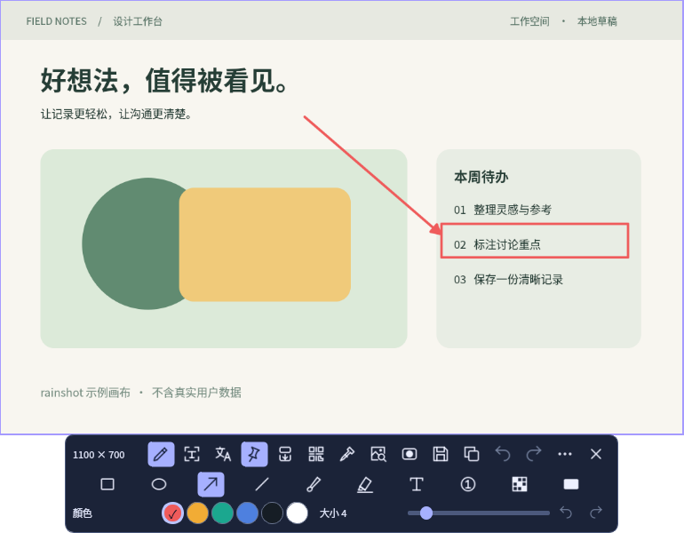
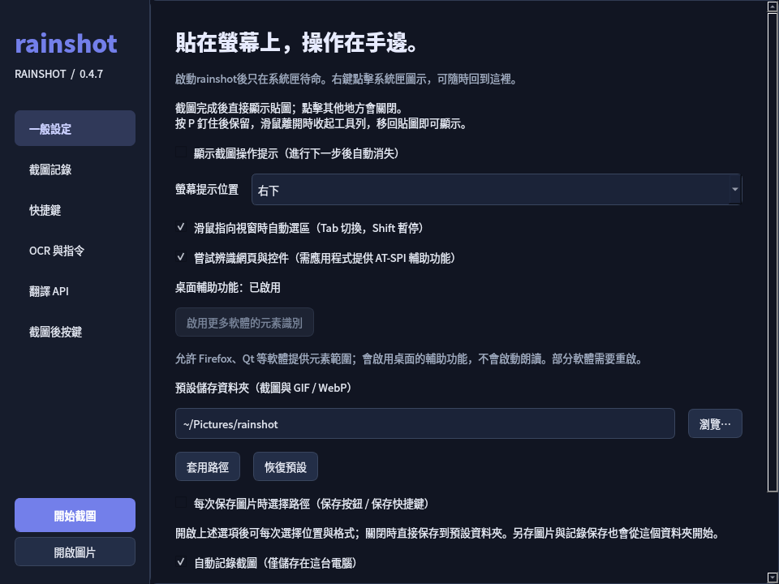

# rainshot

**Capture, pin, annotate, read and translate — right on your screenshot.**  
**截完直接貼在螢幕上，標註、選字、翻譯都在圖片上完成。**

[English](#english) · [繁體中文](#繁體中文) · [Downloads](https://github.com/hstonc/rainshot/releases/latest) · [Compatibility / 相容性](docs/COMPATIBILITY.md)

Python 3.10+ · Qt 5 · GPL-3.0-or-later · Linux desktop  
**X11 is the primary target. Wayland support is partial.** The interface is currently in Chinese; this README is bilingual.



<details>
<summary>Settings / 設定畫面</summary>



</details>

## English

### What it does

- **Capture and pin:** region/window selection on X11, wheel zoom, opacity control, draggable borderless screenshots, and a toolbar that hides when you leave a pinned image.
- **Select elements:** AT-SPI window, control and web-element snapping; hover a nearby gap to select a group of elements, including irregular layouts. Tab cycles enclosing regions; Shift temporarily disables snapping.
- **Annotate in place:** arrows, shapes, freehand drawing, text, highlight, mosaic and covering; undo/redo and inline text editing.
- **Read and translate:** local OCR with selectable text over the image; translation replaces the original text regions. Optional RapidOCR or system Tesseract. Google/Microsoft keyless web endpoints and configurable API providers are available.
- **More image tools:** local QR recognition, a pixel magnifier with HEX/RGB, screenshot history, and browser handoff for reverse image search.
- **X11 capture tools:** vertical scrolling screenshots and silent GIF/animated WebP region recording.

Successful saves close the screenshot and leave a clickable folder notification. Starting the app without arguments only starts the tray; it does not capture.

### Install

Download a package from [Releases](https://github.com/hstonc/rainshot/releases/latest). Exit any running instance before upgrading.

| System | Format | Validation level |
|---|---|---|
| Linux Mint / Ubuntu / Debian family | `.deb` | Desktop testing on Mint 21.3 Cinnamon/X11; Ubuntu CI is headless |
| Arch Linux family | `.pkg.tar.zst`, checksum-pinned PKGBUILD bundle | Experimental; check the release's container build results; no physical desktop certification |
| Fedora | `.noarch.rpm` | Experimental; container build/import checks do not certify a desktop session |
| Other Linux distributions | source `.tar.gz` | Install native dependencies and run `./run.sh`; not a self-contained runtime |

Only artifacts successfully built for a release are published. Package architecture `all`/`any`/`noarch` describes the Python application files, **not** a guarantee that every CPU, distribution or desktop works.

```bash
# Mint / Ubuntu / Debian
sudo apt install ./rainshot_0.4.7_all.deb

# Arch, if the native package is listed in the release
sudo pacman -U ./rainshot-0.4.7-1-any.pkg.tar.zst

# Fedora, if the RPM is listed in the release
sudo dnf install ./rainshot-0.4.7-1.noarch.rpm

rainshot
```

For Arch local builds, download the source archive and the `arch-build` archive from the same release, verify `SHA256SUMS`, extract the recipe, put the source archive beside `PKGBUILD`, then run `makepkg -si` as a regular user. This is not an AUR listing.

### X11 and Wayland

| Feature | X11 | Wayland |
|---|---|---|
| Region capture | Native selection | Implemented through the system Screenshot portal; prompts and UI depend on the desktop |
| Window/element/group snapping | AT-SPI when the application exposes geometry | Not implemented |
| Floating images, annotation, local OCR, translation, QR, color picker | Available | Available after capture; placement, focus and always-on-top behavior depend on the compositor |
| Continuous scrolling capture, GIF/WebP recording | Available | Not implemented; no PipeWire ScreenCast capture in this version |
| Global capture keys | In-app X11 bindings | Bind commands in the desktop's keyboard settings; no GlobalShortcuts portal integration |
| Moving pinned images between workspaces | Window-manager move on X11 | Compositor-dependent; not verified |

Physical desktop testing is limited to **Linux Mint 21.3, Cinnamon, X11, two monitors, 100% scaling**. There is no claim of physical testing on GNOME/KDE Wayland, Arch, Fedora, mixed DPI or ARM. Portal protocol tests and build jobs are not substitutes for desktop testing. See the [full compatibility record](docs/COMPATIBILITY.md).

If Firefox or Qt only exposes an entire window, open Settings → General and use **啟用更多軟體的元素識別**. This enables the desktop accessibility bridge without enabling a screen reader. Some applications need a restart. Canvas, games and controls without AT-SPI geometry may still need manual selection.

### Keys and commands

| Default key after capture | Action |
|---|---|
| P / S / G | Pin / scrolling capture / GIF or WebP recording |
| O / T / Q | OCR / translate / QR recognition |
| I / C | Enter pixel picker / copy its color and leave picker |
| Ctrl+C / Ctrl+S | Copy / save |
| Ctrl+Z / Ctrl+Shift+Z | Undo / redo |
| X; Enter / Shift+Enter | Inline text; confirm / new line |

Post-capture shortcuts are configurable. Global commands can also be bound in desktop settings:

```bash
rainshot --capture       # region capture
rainshot --scroll        # select a region for scrolling capture (X11)
rainshot --record        # select a recording region (X11)
rainshot --settings      # settings and OCR installation commands
rainshot --history      # screenshot history
rainshot --diagnose      # environment report; does not capture
rainshot --quit
```

### OCR, translation and privacy

OCR runs locally. Tesseract needs installed language packs; optional RapidOCR uses a separate Python environment and separately installed models. Model quality varies with fonts, contrast and layout. OCR models are not bundled in these packages.

Translation sends **recognized/selected text** to the service you choose when you request it; it does not upload the screenshot. Keyless Google/Microsoft web endpoints can change or stop working. Other providers, including Qwen/DeepL/DeepSeek/Youdao, need their own configuration and usually a key. Rainshot does not depend on Snow Shot's backend. API keys are held in process memory or read from environment variables, not saved as settings.

Screenshot history is local and can be disabled or cleared. Reverse image search opens a browser workflow; you explicitly drag or upload the prepared image there. There is no telemetry or automatic image upload in the application.

### Development and attribution

Install distribution dependencies described in [BUILDING.md](docs/BUILDING.md), then:

```bash
./run.sh
PYTHONPATH=. /usr/bin/python3 -m pytest -q
python3 packaging/build_release.py dist
```

The initial screenshot workflow was inspired by [Snow Shot](https://github.com/xiaofeiTM233/snow-shot) and [Snow Apps](https://github.com/mg-chao/snow-apps), with [Flameshot](https://github.com/flameshot-org/flameshot) as another Linux reference. Rainshot is a separate Python/Qt implementation with its own repository history, **not a GitHub fork or an official Linux port**. This describes the implementation and repository relationship; upstream projects retain their own licenses and asset rights. See [provenance and acknowledgements](docs/PROVENANCE.md), [NOTICE](NOTICE) and [GPL-3.0-or-later](LICENSE).

Issues should include app version, distribution, desktop, X11/Wayland, scaling, steps and `rainshot --diagnose` output. The [validation record](docs/VALIDATION.md) distinguishes automated and native tests; [release building](docs/RELEASING.md) explains the artifacts.

## 繁體中文

### 功能

- **截圖與貼圖：** X11 區域／視窗選取、滾輪縮放、透明度、無邊框拖曳；釘住後滑鼠離開時收起工具列。
- **元素選區：** 透過 AT-SPI 吸附視窗、控件及網頁元素；指向鄰近間隙可選取多個元素的共同外框，支援不規則排列。Tab 切換父層，Shift 暫停吸附。
- **直接標註：** 箭頭、形狀、畫筆、文字、螢光、馬賽克與遮蓋；支援上一步／下一步與圖片上直接輸入文字。
- **識別與翻譯：** 本機 OCR 結果可直接在圖片上選字，譯文覆蓋原文字區域；可選 RapidOCR 或系統 Tesseract，以及免金鑰網頁翻譯入口或自訂 API。
- **圖片工具：** 本機二維碼識別、精確像素放大取色、截圖記錄，以及交給瀏覽器操作的以圖搜圖。
- **X11 擷取工具：** 垂直捲動長截圖、無聲 GIF／動態 WebP 區域錄製。

保存成功後關閉貼圖，僅留下可點擊開啟資料夾的提示。直接啟動程式只在系統匣待命，不會自動截圖。目前介面以中文為主。

### 安裝

到 [Releases](https://github.com/hstonc/rainshot/releases/latest) 下載適用的套件，升級前先退出執行中的舊版。

| 系統 | 格式 | 驗證範圍 |
|---|---|---|
| Mint／Ubuntu／Debian 系列 | `.deb` | Mint 21.3 Cinnamon／X11 有桌面實測；Ubuntu CI 為無桌面測試 |
| Arch 系列 | `.pkg.tar.zst`、固定來源雜湊的 PKGBUILD 組合包 | 實驗性；以該 Release 的容器建包結果為準，未作桌面實機認證 |
| Fedora | `.noarch.rpm` | 實驗性；容器建包及匯入檢查不代表桌面功能已驗證 |
| 其他 Linux | 原始碼 `.tar.gz` | 安裝系統依賴後 `./run.sh`，不是自帶所有執行環境的單檔程式 |

僅發布該版本成功建出的套件。`all`／`any`／`noarch` 表示應用檔案不含特定 CPU 的編譯碼，不表示所有發行版、CPU 或桌面環境都能使用。

```bash
# Mint / Ubuntu / Debian
sudo apt install ./rainshot_0.4.7_all.deb
# Arch：Release 有提供原生套件時
sudo pacman -U ./rainshot-0.4.7-1-any.pkg.tar.zst
# Fedora：Release 有提供 RPM 時
sudo dnf install ./rainshot-0.4.7-1.noarch.rpm
rainshot
```

Arch 也能下載同一版本的來源與 `arch-build` 壓縮包，先核對 `SHA256SUMS`，解開建包配方後把來源壓縮包放在 `PKGBUILD` 旁，以一般使用者執行 `makepkg -si`。目前未上架 AUR。

### X11／Wayland 相容性

| 功能 | X11 | Wayland |
|---|---|---|
| 區域截圖 | 原生選區 | 已實作系統 Screenshot Portal；授權與選區介面依桌面決定 |
| 視窗／元素／群組吸附 | 應用提供 AT-SPI 幾何時可用 | 尚未實作 |
| 貼圖、標註、OCR、翻譯、QR、取色 | 可用 | 截取後可用；定位、焦點與置頂依合成器而異 |
| 連續長截、GIF／WebP 錄製 | 可用 | 尚未實作，沒有 PipeWire ScreenCast 擷取 |
| 全域截圖快捷鍵 | 程式內 X11 綁定 | 請在系統鍵盤設定綁定命令，尚無 GlobalShortcuts Portal |
| 貼圖跨工作區移動 | 使用 X11 視窗管理器移動 | 由合成器決定，未驗證 |

桌面實測環境有限：**Linux Mint 21.3、Cinnamon、X11、雙螢幕、100% 縮放**。未宣稱實機驗證 GNOME／KDE Wayland、Arch、Fedora、混合 DPI 或 ARM。Portal 協議測試與成功建包不能取代桌面測試，詳見 [相容性記錄](docs/COMPATIBILITY.md)。

Firefox／Qt 若只能選到整個視窗，到「設定 → 一般設定」按 **啟用更多軟體的元素識別**，允許桌面提供輔助功能資料；不會啟動朗讀，部分軟體需要重啟。Canvas、遊戲、自繪或未公開元素的介面仍可能需要手動框選。

### 操作與快捷鍵

預設 P 釘住、S 長截、G 錄製、O 識別文字、T 翻譯、Q 二維碼、I 取色；取色時 C 複製色碼並退出模式。Ctrl+C／Ctrl+S 複製／保存，Ctrl+Z／Ctrl+Shift+Z 上一步／下一步。X 在圖片上輸入文字，Enter 確認、Shift+Enter 換行。

截圖後按鍵可以自訂；全域命令可用上方的 `rainshot --capture` 等命令交由系統綁定。更多操作、OCR 安裝與翻譯設定見 [繁體中文使用指南](docs/USER_GUIDE.zh-TW.md)。

### 資料與來源

OCR 在本機執行，Tesseract 需要語言包；RapidOCR 為另行安裝的環境與模型，套件不內附模型。辨識率仍受字型與排版影響。

翻譯僅在要求時把**識別／選取的文字**送到所選服務，不上傳截圖。Google／Microsoft 的免金鑰網頁入口可能變更或失效；通義千問、DeepL、DeepSeek、有道等需依服務設定，通常需要自己的金鑰。rainshot 不使用 Snow Shot 自有後端，金鑰僅留在行程記憶體或從環境變數讀取，不寫入設定檔。

截圖記錄保留在本機，可關閉或清除。以圖搜圖由使用者在瀏覽器拖曳／上傳圖片；程式沒有遙測或自動上傳圖片。

最初的操作流程受 [Snow Shot](https://github.com/xiaofeiTM233/snow-shot)、[Snow Apps](https://github.com/mg-chao/snow-apps) 啟發，也參考 [Flameshot](https://github.com/flameshot-org/flameshot)。rainshot 是另行開發的 Python／Qt 應用，擁有自己的倉庫歷史，**不是 GitHub fork，也不是官方 Linux 移植版**。上游程式與資產維持各自權利；來源查核、致謝與授權範圍見 [PROVENANCE](docs/PROVENANCE.md)、[NOTICE](NOTICE) 和 [GPL-3.0-or-later](LICENSE)。

開發與發行： [建置說明](docs/BUILDING.md) · [驗證記錄](docs/VALIDATION.md) · [發行流程](docs/RELEASING.md)。問題回報請附版本、發行版、桌面、X11／Wayland、縮放比例、重現步驟與 `rainshot --diagnose` 結果。
